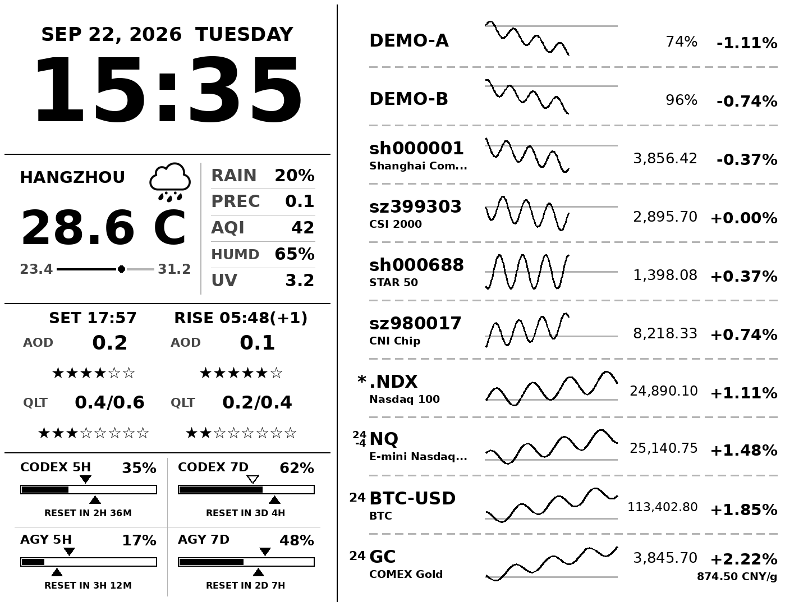
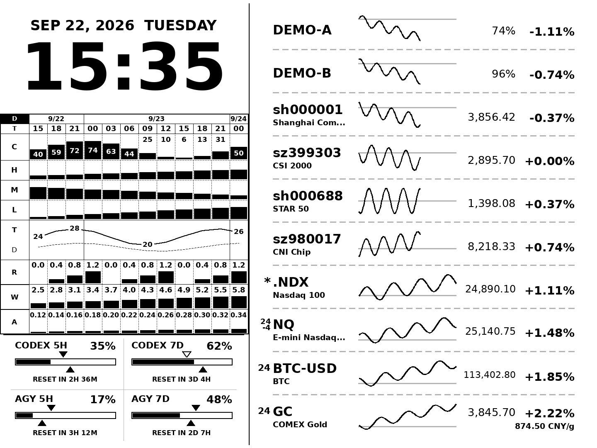
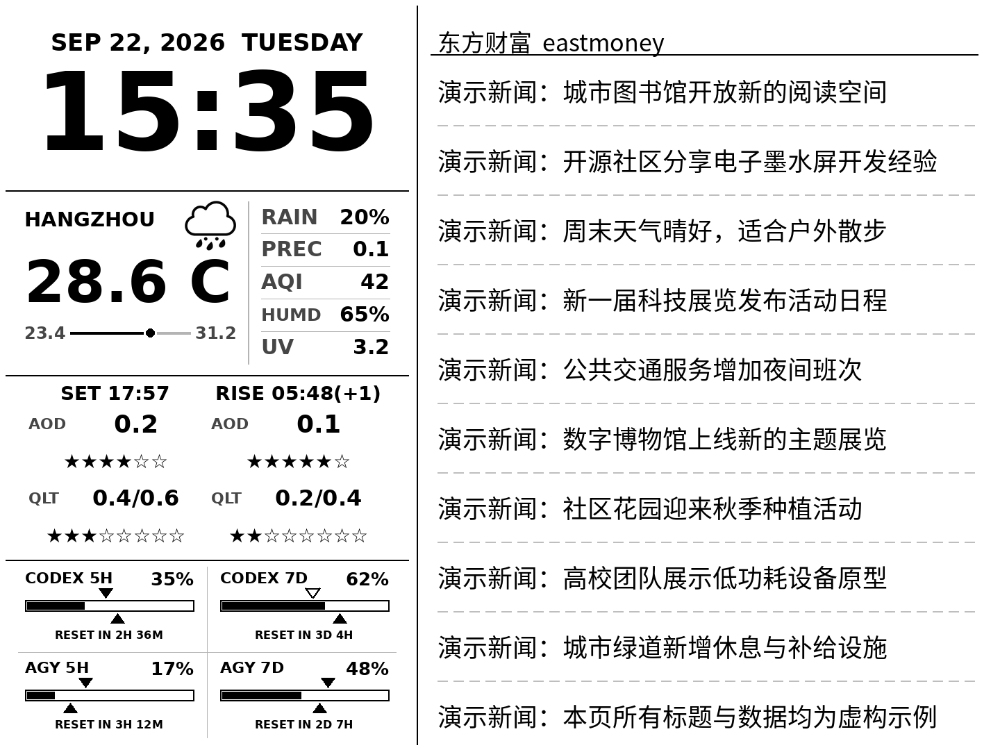
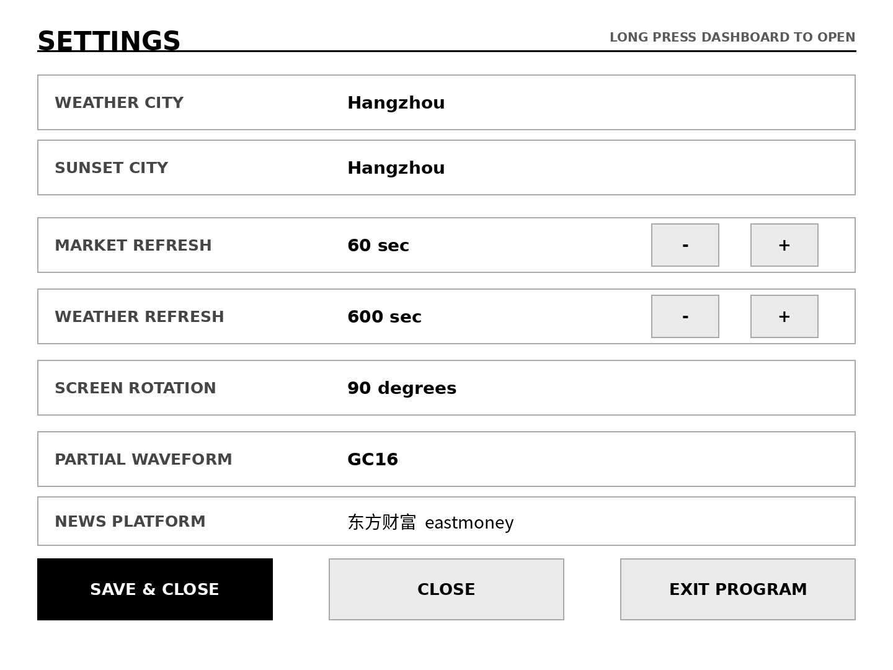
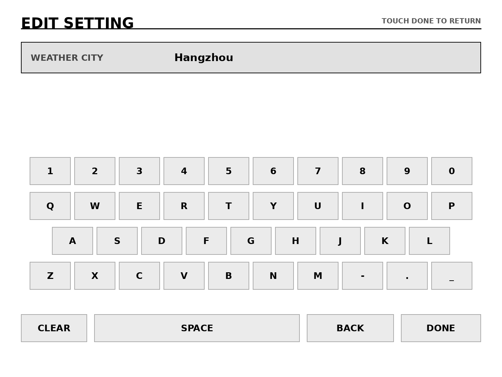
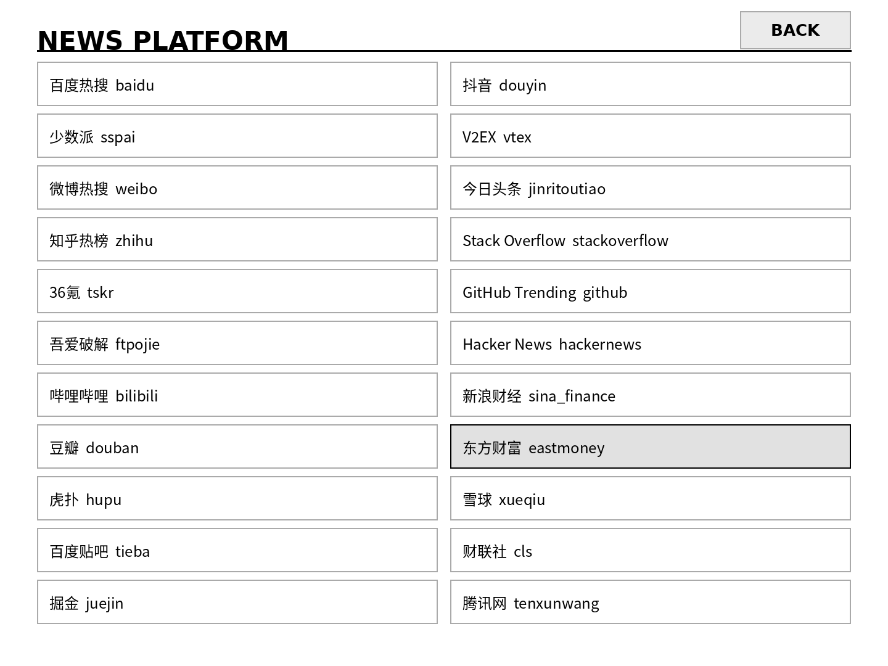
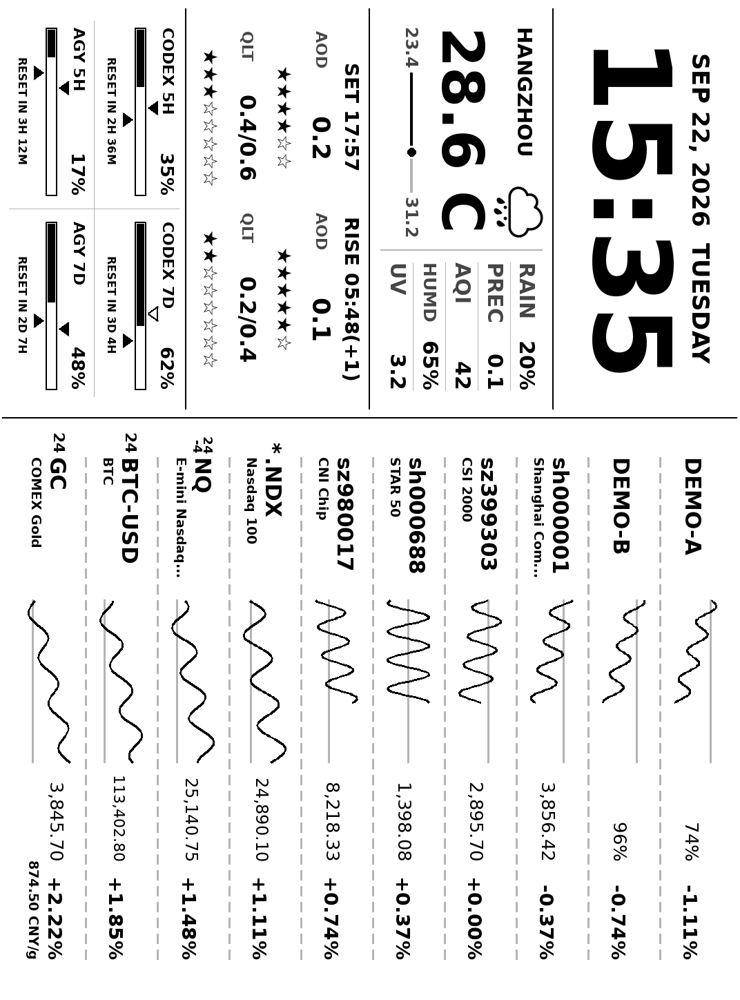

<div align="center">

# Kindle Dashboard

### 给闲置 Kindle，一块安静的信息面板。

行情 · 天气 · 日出日落 · 云图 · 新闻 · Agent 用量

原生 C++17 在设备本地取数、排版与绘制，专为电子墨水屏设计。


[截图预览](#截图预览) · [快速开始](#快速开始) · [连接真实数据](#连接真实数据) · [部署到 Kindle](#部署到-kindle)



**一屏看完常用信息，让旧设备重新成为桌面的一部分。**

</div>

> 截图由项目的原生渲染器直接输出，行情、用量、新闻与云图均为虚构演示数据；不是实时行情，也不是实机照片。

## 有什么

| 一屏信息 | 面向墨水屏的细节 |
| --- | --- |
| **行情**：指数、期货、加密资产与自定义数据源 | 最多 16 行，分时曲线、涨跌幅、交易进度和休市状态 |
| **天气与日落**：温度、降水、空气质量、日出日落预测 | 支持城市设置、缓存与失败后的旧数据保留 |
| **云图**：未来 36 小时，3 小时一列 | 总／高／中／低云量、温度、露点、降雨、风速与 AOD |
| **新闻**：点击右侧切换新闻与行情 | 中文标题、自动换行、多平台选择 |
| **Agent 用量**：短周期与周周期使用进度 | 支持自己的用量 API，认证信息留在本地 |
| **设备设置**：长按进入触摸设置页 | 城市输入键盘、刷新间隔、屏幕方向与局刷波形 |

- **本地原生运行**：取数、缓存、字体排版、灰度绘制与 FBInk 调用都在设备完成；运行时无需 Python、浏览器或远端截图服务。
- **按区域刷新**：只提交像素发生变化的区域；全刷周期独立计时，减少无意义重绘。
- **保留可用数据**：请求失败继续显示缓存，网络请求并行执行，屏幕提交由主线程完成。
- **先在电脑体验**：Linux / WSLg 原生预览窗口支持缩放、方向切换与离线演示。

## 截图预览

点击图片可查看原图。以下页面都使用公开演示数据，不包含本地接口、账户或产品信息。

<table>
<tr>
<td width="50%" align="center"><b>36 小时云图</b><br><a href="docs/screenshots/cloud.png"></a></td>
<td width="50%" align="center"><b>中文新闻</b><br><a href="docs/screenshots/news.png"></a></td>
</tr>
<tr>
<td align="center"><b>设备设置</b><br><a href="docs/screenshots/settings.png"></a></td>
<td align="center"><b>触摸输入</b><br><a href="docs/screenshots/keyboard.png"></a></td>
</tr>
<tr>
<td align="center"><b>新闻平台选择</b><br><a href="docs/screenshots/news-platforms.png"></a></td>
<td align="center"><b>KPW3 原始屏幕输出</b><br><a href="docs/screenshots/device-output.png"></a><br><sub>1072 × 1448 · 已旋转的设备帧</sub></td>
</tr>
</table>

## 快速开始

### 1. 获取源码

```sh
git clone https://github.com/HBZHSN/kindle-dashboard.git
cd kindle-dashboard
```

### 2. 安装开发依赖

在 Linux 或 WSL Ubuntu 中执行。需要 C++17 编译器、CMake 与 libcurl ≥ 7.85；桌面窗口使用 X11 / WSLg。

```sh
sudo apt update
sudo apt install build-essential cmake libfreetype-dev libharfbuzz-dev \
  libpng-dev libcurl4-openssl-dev libssl-dev libyaml-dev nlohmann-json3-dev libx11-dev
```

### 3. 打开离线演示

**Windows + WSLg**，在项目目录的 PowerShell 中：

```powershell
.\run-wsl.ps1 -Demo
```

脚本会先编译，再打开原生窗口。拖动窗口边缘缩放，按 **R** 切换方向，按 **Esc**、关闭窗口或 **Ctrl+C** 退出。离线演示直接使用 `tests/demo.yaml` 和虚构快照，不需要本地私有配置，也不会访问网络。

**Linux / WSL 终端**：

```sh
cmake -S . -B .build/native -DCMAKE_BUILD_TYPE=Release -DDASHBOARD_WINDOW=ON
cmake --build .build/native -j 4
.build/native/kindle-dashboard --config tests/demo.yaml --window --offline \
  --snapshot tests/sample.json --freeze-time
```

**无桌面环境，输出一帧 PNG**：

```sh
cmake -S . -B .build/native -DCMAKE_BUILD_TYPE=Release -DDASHBOARD_WINDOW=OFF
cmake --build .build/native -j 4
.build/native/kindle-dashboard --config tests/demo.yaml --simulate --offline --once \
  --snapshot tests/sample.json --freeze-time --output preview
```

查看 `preview/frame.png`（横向逻辑画布）、`preview/device.png`（设备帧）以及 `preview/refresh.jsonl`（刷新记录）。

## 连接真实数据

先创建本地配置：

```powershell
Copy-Item config.example.yaml config.yaml
```

Linux / WSL 可使用 `cp -n config.example.yaml config.yaml`。已有 `config.yaml` 时直接编辑，保留原配置。

| 配置项 | 用途 |
| --- | --- |
| `market.mix_symbols` / `market.mix_sources` | 行情列表与 Tencent、Sina、Eastmoney、Binance 等来源 |
| `market.custom_symbols` | 自定义 HTTP 行情；产品名称、地址与参数仅写入本地配置 |
| `weather.location` | 天气城市，也可指定经纬度 |
| `sunset.city` | 日出日落预测城市 |
| `cloud.latitude` / `cloud.longitude` | 云图地点 |
| `cloud.proxy` | 可选代理；为空时直连 |
| `agent_usage.url` / `agent_usage.password` | 自己的用量 API 和认证口令；模板默认不连接 |
| `news.platform` | 新闻平台，可在设置页切换 |
| `refresh.*` / `display.*` | 请求间隔、全刷周期、并行数量、方向与局刷波形 |

```powershell
.\run-wsl.ps1
```

或者运行 `.build/native/kindle-dashboard --window`。程序默认读取项目目录的 `config.yaml`，也可用 `--config` 指定其他文件。

**公开与本地文件的边界**：`master` 只包含源码、公开模板、虚构测试数据和演示截图。真实配置、`.env`、私有参考文件、本地备份、缓存、日志、构建产物和实况截图均被 Git 忽略。程序读取 YAML 配置；忽略 `.env` 并不代表程序会自动加载它。

更多参数与数据行为见 [开发与设备说明](docs/development.md)。

## 在 Kindle 上操作

| 手势 | 操作 |
| --- | --- |
| 点击右侧 | 在行情与新闻之间切换 |
| 点击 Sunset 或云图区域 | 切换天气 + 日落和云图视图 |
| 长按约 1.2 秒 | 打开设置页 |
| `SAVE & CLOSE` | 原子保存设置并返回仪表盘 |
| `CLOSE` | 放弃当前修改 |
| `EXIT PROGRAM` | 退出并恢复 Kindle 系统界面 |

Sunset 数据不可用，或最近两个事件的有效 EC / GFS QLT 都低于 0.2 时，自动显示云图；任一有效 QLT 高于 0.2 时恢复 Sunset。手动选择保持到下一次数据判定。

## 部署到 Kindle

目标设备为 **Kindle Paperwhite 3**，需具备运行自定义程序的环境与支持图像的 [FBInk](https://github.com/NiLuJe/FBInk)。其他型号的分辨率、触摸和系统服务需要单独适配。

桌面构建产物是 x86-64 程序，Kindle 使用独立的 ARM 静态构建：

```powershell
.\tools\prepare-arm.ps1
python tools/prepare_native_headers.py
wsl -d Ubuntu -- bash tools/build-arm.sh
wsl -d Ubuntu -- bash tools/package-arm.sh
.\tools\deploy-kindle.ps1 -Device kindle.local -Port 2222
```

将 `kindle.local` 与端口改为自己的设备地址，也可通过本地环境变量 `KINDLE_HOST` 指定地址。部署脚本校验安装包，更新程序与菜单扩展，失败时尝试恢复旧版本。详见 [ARM 构建与设备说明](docs/development.md#arm-构建与设备)。

**安装包会包含本地 `config.yaml`，只用于自己的设备；不要将本地 `dist/` 上传为公开附件。** 仓库仅发布源码与演示截图。

## 开发与检查

```sh
ctest --test-dir .build/native --output-on-failure
python3 tests/integration.py
```

原生检查覆盖区域刷新、相同内容零刷新、旋转、布局变化、配置校验、字体渲染、设置页渲染和 FBInk 失败重试。HTTP 集成检查使用本地回环服务，覆盖行情协议、云图代理与直连、天气、Sunset、用量、新闻及失败缓存，不调用真实业务接口。

```text
src/                 C++ 调度、数据协议、灰度绘制与设备输出
assets/              字体、天气图标与交易日历
kindle/              服务控制与 Kindle 菜单扩展
cmake/               ARM 工具链配置
tools/               构建、素材准备与部署脚本
tests/               原生检查、回环接口检查与公开演示数据
docs/screenshots/    只使用虚构数据的界面截图
config.example.yaml  无私有地址与口令的配置模板
```

内置交易日历覆盖 **2020–2026**；未来年份需更新日历。桌面测试不能代替实机墨水屏波形、残影、休眠和长期运行验证。

## 致谢

视觉参考：[kindle.lenscoder.cn](https://kindle.lenscoder.cn/dash.html)。字体与底层渲染依赖 FreeType、HarfBuzz、DejaVu Sans 与 Noto Sans SC；天气与云图使用 Open-Meteo、MET Norway 等数据源；设备显示通过 FBInk 完成。

第三方来源和许可证说明见 [THIRD_PARTY.md](THIRD_PARTY.md) 与 `assets/fonts/` 下的许可文件。
